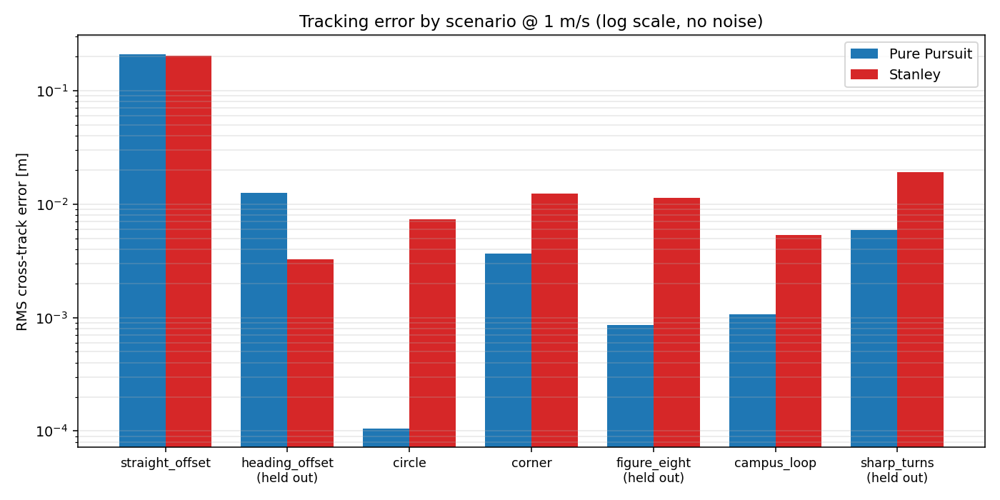
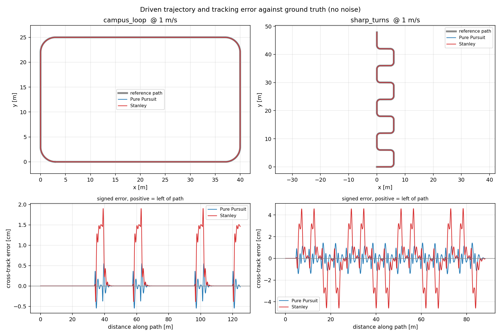

# ros2-campus-shuttle

A ROS 2 autonomy stack for a differential-drive campus shuttle, in simulation.

The point of this repository is not that the robot navigates. It is a
**measured, like-for-like comparison of Pure Pursuit against Stanley path
tracking**: same robot, same paths, same speeds, same disturbances, with
cross-track and heading error quantified against ground truth and an honest
conclusion about which is better and when.



## The result

Across 84 runs — 7 scenarios × 3 speeds × noise on/off × 2 controllers, none of
which failed to finish:

| Scenario | Tuned on | Pure Pursuit RMS | Stanley RMS | Closer |
| --- | --- | ---: | ---: | :---: |
| `straight_offset` (1 m step) | yes | 0.2101 m | **0.2028 m** | Stanley |
| `heading_offset` (30° step) | held out | 0.0126 m | **0.0033 m** | Stanley |
| `circle` (R = 6 m) | yes | **0.0001 m** | 0.0073 m | Pure Pursuit |
| `corner` (1.5 m turns) | yes | **0.0037 m** | 0.0124 m | Pure Pursuit |
| `figure_eight` | held out | **0.0009 m** | 0.0114 m | Pure Pursuit |
| `campus_loop` (125 m) | yes | **0.0011 m** | 0.0054 m | Pure Pursuit |
| `sharp_turns` (1.2 m turns) | held out | **0.0059 m** | 0.0192 m | Pure Pursuit |

*At 1.0 m/s, no odometry noise, measured at `base_link` against ground truth.*

**Neither controller wins outright, and that is the finding.**

- **Pure Pursuit holds a line far better once on it.** On every curved route it
  is 3–10× tighter. On a constant-radius arc its commanded curvature equals
  `1/R` *exactly* — the geometry is not an approximation there — which is why
  `circle` comes out at 0.1 mm.
- **Stanley re-acquires a path more gracefully.** It carries a lower RMS error
  through both step scenarios and, more usefully, **gets onto the line without
  overshooting it**. Recovering from a 30° heading error it never leaves a 5 cm
  band, while Pure Pursuit swings 8.3 cm past the path before settling.
- **The two trade settling time against overshoot.** From a 1 m lateral offset
  at 1.5 m/s, Pure Pursuit is inside 5 cm after 1.07 m but overshoots by
  3.6 cm; Stanley takes 3.45 m to get inside that band but overshoots only
  0.9 cm. RMS alone hides this, so `docs/RESULTS.md` reports settling distance
  and overshoot separately.
- **Stanley overshoots at corner exits.** Visible as the ±2 cm ringing on
  `campus_loop` and ±4.5 cm on `sharp_turns` in the figure below, against Pure
  Pursuit's ±0.5 cm. It regulates error at a virtual front axle, so it commits
  to the turn later and unwinds it harder.
- **Both degrade about the same with odometry noise** (+24.1% against +24.5%),
  so the usual claim that Stanley is the more heading-noise-sensitive of the two
  is not reproduced at these gains and speeds.

So: **Pure Pursuit for route following, Stanley if the robot is frequently
re-acquiring a path** — after a replan, a manual takeover, or a localisation
jump — and particularly where overshooting the path is worse than taking longer
to reach it, which on a pedestrian campus it usually is.



Full numbers, including the speed sweep and control effort:
**[docs/RESULTS.md](docs/RESULTS.md)** — generated from the raw CSV, not written
by hand.

## Reproducing it

```bash
docker compose up
```

That builds a small Debian image, runs the controller unit tests, tunes both
controllers by grid search, runs all 84 comparison runs, and regenerates every
figure and `docs/RESULTS.md`. It takes about a minute, and needs no ROS, no
Gazebo and no GPU.

Every number in this README comes out of that command.

```bash
docker compose run --rm test          # all checks that don't need ROS
docker compose run --rm calibration   # camera-to-LiDAR extrinsics
```

## How the comparison is kept fair

This is the part that matters, and most of the design follows from it.

- **The longitudinal controller is shared code.** Both trackers pick speed with
  the same lateral-acceleration and deceleration-to-goal limits. If they also
  disagreed about speed, any difference in tracking error could be explained by
  one of them simply taking the corner slower.
- **Error is reported at `base_link` for both**, even though Stanley internally
  regulates error at a virtual front axle — a different and smaller quantity.
- **Error is measured against ground truth**, never against the pose the
  controller was given. A controller that tracks a drifting estimate beautifully
  should score badly, and this is what makes that happen.
- **The noise seed is derived from the scenario, speed and noise setting, never
  from the controller**, so both face a bit-identical disturbance sequence.
- **Gains are fitted by grid search, not chosen by hand**, on a tuning subset,
  and reported on all seven scenarios. `heading_offset`, `figure_eight` and
  `sharp_turns` are held out; `sharp_turns` uses corners tighter than anything
  in the tuning set.
- **A 100 ms sensing latency is modelled.** Without it the tuner drives the
  Pure Pursuit lookahead to 0.15 m, because in a latency-free world a shorter
  lookahead simply tracks better. Latency is what makes an unreasonably short
  lookahead oscillate.
- **The tuning objective penalises control effort**, not just error. Minimising
  error alone selects the most aggressive gains on the grid, right at the edge
  of oscillation.

## What is here

| | |
| --- | --- |
| **Controllers** | Pure Pursuit and Stanley in C++, as a standalone node **and** as `nav2_core::Controller` plugins |
| **Simulation** | Gazebo Classic world, URDF with 2D LiDAR, IMU, RGB camera and a ground-truth pose plugin |
| **Localisation** | Two `robot_localization` EKF instances (local `odom`, global `map`), with a NEES-based consistency check against ground truth |
| **Navigation** | Nav2 with both controllers registered; SLAM Toolbox for mapping, AMCL for localisation |
| **Calibration** | Camera-to-LiDAR extrinsics by point-to-plane least squares, with observability checking |
| **Analysis** | Automated comparison harness, figures and results document generated from raw CSV |

### The core design decision

Everything in `src/shuttle_control/core/` compiles against the C++ standard
library and nothing else. The same object files are linked into the ROS 2 node,
the Nav2 plugins and the offline benchmark:

```
                    shuttle_control_core
                   (Path, SpeedLimiter,
                PurePursuit, Stanley, metrics)
                             |
        +--------------------+--------------------+
        |                    |                    |
  path_tracker_node    Nav2 plugins        controller_bench
   (ROS 2 node)     (nav2_core::Controller)  (offline, no ROS)
```

So the comparison runs in seconds on any machine, and the code being compared is
provably the same code Nav2 loads. More in
**[docs/ARCHITECTURE.md](docs/ARCHITECTURE.md)**.

## Camera-to-LiDAR calibration

Solved as point-to-plane least squares: a checkerboard gives the board plane in
the camera frame, the LiDAR gives points on that same board, and the extrinsic
is the transform that puts those points on that plane.

Against a known transform with 12 board poses and 1440 points:

| | |
| --- | --- |
| Residual (RMS point-to-plane) | **12.0 mm** |
| Translation error vs truth | 8.3 mm |
| Rotation error vs truth | 0.37° |
| Jacobian condition number | 116 |

The residual sits exactly at the injected 12 mm LiDAR noise floor, which is the
useful check: the estimator is noise-limited, not model-limited. The solver also
reports the condition number and warns when the board poses are close to
degenerate — near-parallel boards leave rotation about the shared normal
unobservable, and a solver that does not check will return a confident wrong
answer. `tests/test_calibration.py` verifies all of this.

Reproduce with `docker compose run --rm calibration`. Details and the
real-robot capture procedure: **[calibration/procedure.md](calibration/procedure.md)**.

## Running the simulation

The full ROS 2 + Gazebo image is a multi-gigabyte pull and is **not** needed for
the results above.

```bash
# Interactive shell in the simulation image
docker compose --profile sim run --rm sim

# Then, inside:
ros2 launch shuttle_bringup slam.launch.py rviz:=true      # map the world
ros2 launch shuttle_bringup nav2.launch.py rviz:=true      # full autonomy
ros2 launch shuttle_bringup comparison.launch.py \
    controller:=stanley scenario:=campus_loop              # one measured run
```

The Gazebo cross-check runs the identical controller code against the physics
engine, scored against the Gazebo ground-truth pose:

```bash
docker compose --profile sim run --rm gazebo-comparison
```

Which tracker Nav2 uses is a parameter, not a rebuild: both are registered as
plugins in `config/nav2_params.yaml` under the ids `FollowPath` and
`StanleyPath`.

## Tests

| Test | Covers |
| --- | --- |
| `test_core` (C++, 142 checks) | Path geometry, projection sign conventions, speed limiter, plant integration, steering signs, determinism, path continuity |
| `tests/test_scenarios_match.py` | The C++ and Python scenario generators agree (currently to under a micrometre) |
| `tests/test_calibration.py` | Calibration accuracy, residual at the noise floor, degeneracy detection |
| `tests/test_param_files.py` | Every ROS 2 parameter file will actually load |
| `scripts/verify_ros.sh` | Plugin registration, URDF expansion, message generation, launch-file parsing |

The path-continuity check exists for a reason. An early version of the
`sharp_turns` generator emitted a path that jumped backwards by 1.15 m at one
corner. Both controllers stalled there and it looked exactly like a controller
defect — the "finding" would have been that Pure Pursuit limit-cycles on tight
turns. It was a broken reference path. A comparison is only worth reporting if
the reference trajectories are sound, so they are now checked rather than
assumed.

`test_param_files.py` has a similar origin. The EKF covariance matrices were
written with a mix of `0` and `0.02`; ROS 2 requires a parameter sequence to be
homogeneous and rejected the entire file, so `ekf_node` died at startup and the
only visible symptom was a disconnected TF tree and a robot that never moved.
Nothing in a build catches that, so it is checked directly.

## Limitations

Stated plainly, because they bound what the numbers mean.

- **This is simulation only.** No hardware bringup, no Jetson Orin, no physical
  emergency stop. The BEng project this rebuilds ran on hardware; this does not.
- **Stanley on a differential drive requires an adaptation.** The published law
  is defined for a front-wheel-steered vehicle. Applying it here needs a
  *virtual front axle* distance `L_fa`, which acts as a wheelbase. It is a
  tuning parameter of the adaptation, not a property of the robot, and a
  different `L_fa` moves Stanley's numbers. This is the largest caveat on the
  comparison — see [docs/CONTROLLERS.md](docs/CONTROLLERS.md).
- **The headline numbers come from a kinematic benchmark**, which models
  actuator lag, wheel saturation, sensing latency and odometry noise, but not
  wheel slip, tyre dynamics or LiDAR mis-association. The Gazebo pipeline
  exercises the same controller code against a physics engine and is built,
  launched and smoke-tested; treat its output as the higher-fidelity check and
  the bench numbers as the reproducible ones.
- **Absolute errors are small because the plant is well behaved.** The
  comparison between the two columns is the result; the magnitude of either is
  not a claim about a real vehicle.
- **The comparison runs deliberately bypass AMCL**, using ground truth for the
  map frame, so that localisation error does not contaminate the controller
  measurement. Real total path error would be larger.
- **The LiDAR is 2D.** One horizontal plane at 0.32 m. Fine for a supervised
  demonstration, not sufficient for operating unsupervised around people. See
  [docs/SAFETY.md](docs/SAFETY.md).
- **MuJoCo is not implemented.** The original brief listed it alongside Gazebo;
  a second physics engine adds no evidence the comparison needs, so the effort
  went into the ROS-free benchmark instead.
- **No dissertation PDF or demo video** in this repository.

## Repository layout

```
src/
  shuttle_msgs/           TrackingError, ControllerMetrics
  shuttle_description/    URDF, Gazebo sensor plugins, RViz configs
  shuttle_control/        controllers (core/ is ROS-free), node, Nav2 plugins, bench
  shuttle_localisation/   EKF ground-truth evaluation, reference-path publisher
  shuttle_perception/     camera-to-LiDAR extrinsic calibration
  shuttle_bringup/        launch files and all YAML parameters
simulation/worlds/        Gazebo campus world
analysis/                 comparison plots and the results generator
calibration/              extrinsics and the capture procedure
docs/                     architecture, controllers, results, safety
scripts/                  run_bench.sh, run_comparison.sh, run_calibration.sh
tests/
```

## Documentation

- **[docs/RESULTS.md](docs/RESULTS.md)** — full comparison, generated from the data
- **[docs/CONTROLLERS.md](docs/CONTROLLERS.md)** — the maths, the diff-drive Stanley adaptation, tuning
- **[docs/ARCHITECTURE.md](docs/ARCHITECTURE.md)** — packages, frames, how a run works
- **[docs/SAFETY.md](docs/SAFETY.md)** — hazards, mitigations, what is not simulated
- **[calibration/procedure.md](calibration/procedure.md)** — calibration method and capture procedure

## Licence

MIT — see [LICENSE](LICENSE).
