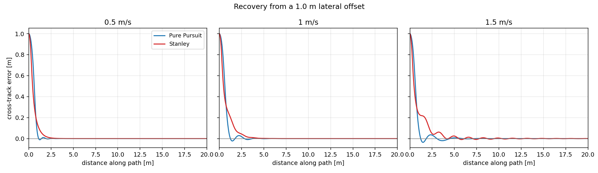
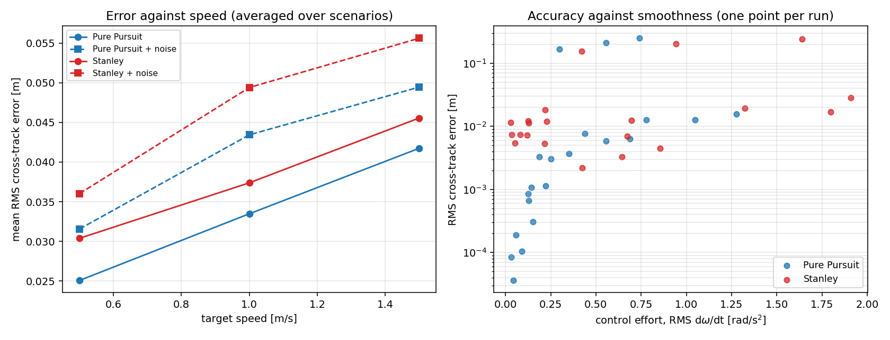

# Controller comparison results

Generated by `analysis/compare_controllers.py` from `results/bench/metrics.csv`. Do not edit by hand: `scripts/run_bench.sh` regenerates the whole file.

## Conclusion

Pure Pursuit tracks curvature more closely, winning 5 of the 5 steady-state routes. Stanley holds a lower RMS error through the transient on 2 of the 2 step scenarios, and reaches the path without overshooting where Pure Pursuit overshoots. Neither controller dominates: the choice depends on whether the robot spends its time re-acquiring a path or holding one.

## How the comparison is kept fair

- Both controllers drive the **same** reference paths from the **same** start poses at the **same** speeds.
- The longitudinal (speed) law is shared code. Only the lateral control law differs, so a difference in tracking error cannot be explained by one controller simply taking corners slower.
- Cross-track error is reported at `base_link` for both, even though Stanley internally regulates the error at a virtual front axle.
- Errors are measured against **ground truth**, not against the noisy pose the controller was given.
- The odometry noise sequence is seeded from the scenario, speed and noise setting only, never from the controller, so both face an identical disturbance realisation.
- A 100 ms sensing latency is modelled, because without it the tuning step selects gains that are only optimal in a perfect world.
- Gains are fitted by grid search on `campus_loop`, `circle`, `corner`, `straight_offset` and reported on all scenarios, so the held-out routes test generalisation.

## Per-scenario, at 1 m/s, no noise

| Scenario | Tuned on | PP RMS (m) | Stanley RMS (m) | PP max (m) | Stanley max (m) | Closer |
| --- | --- | ---: | ---: | ---: | ---: | :---: |
| `straight_offset` | yes | 0.2101 | 0.2028 | 1.0000 | 1.0000 | Stanley |
| `heading_offset` | held out | 0.0126 | 0.0033 | 0.0831 | 0.0243 | Stanley |
| `circle` | yes | 0.0001 | 0.0073 | 0.0007 | 0.0075 | PP |
| `corner` | yes | 0.0037 | 0.0124 | 0.0108 | 0.0372 | PP |
| `figure_eight` | held out | 0.0009 | 0.0114 | 0.0025 | 0.0251 | PP |
| `campus_loop` | yes | 0.0011 | 0.0054 | 0.0055 | 0.0190 | PP |
| `sharp_turns` | held out | 0.0059 | 0.0192 | 0.0142 | 0.0460 | PP |

## Step response

RMS alone is misleading on a step. A controller that sheds most of the error quickly and then creeps in can beat one that reaches the tight band sooner but overshoots, so settling distance and overshoot are reported separately. `settles` is the distance travelled before the error stays inside 5 cm; `overshoot` is the furthest excursion past the path on the far side.

| Scenario | Speed | PP settles within 5 cm | Stanley settles | PP overshoot | Stanley overshoot |
| --- | ---: | ---: | ---: | ---: | ---: |
| `straight_offset` | 0.5 m/s | 0.95 m | 1.46 m | 1.1 cm | 0.0 cm |
| `straight_offset` | 1 m/s | 1.06 m | 2.30 m | 2.3 cm | 0.0 cm |
| `straight_offset` | 1.5 m/s | 1.07 m | 3.45 m | 3.6 cm | 0.9 cm |
| `heading_offset` | 0.5 m/s | 0.58 m | 0.00 m | 6.1 cm | 0.6 cm |
| `heading_offset` | 1 m/s | 0.76 m | 0.00 m | 8.3 cm | 1.0 cm |
| `heading_offset` | 1.5 m/s | 0.76 m | 0.00 m | 8.3 cm | 1.0 cm |

## Across speed and noise (averaged over all scenarios)

| Speed (m/s) | Noise | PP RMS (m) | Stanley RMS (m) | PP effort | Stanley effort |
| ---: | :---: | ---: | ---: | ---: | ---: |
| 0.5 | no | 0.0251 | 0.0304 | 0.21 | 0.19 |
| 0.5 | yes | 0.0316 | 0.0360 | 5.51 | 2.76 |
| 1 | no | 0.0335 | 0.0374 | 0.41 | 0.58 |
| 1 | yes | 0.0434 | 0.0494 | 3.34 | 3.27 |
| 1.5 | no | 0.0417 | 0.0456 | 0.55 | 1.03 |
| 1.5 | yes | 0.0495 | 0.0556 | 2.86 | 3.70 |

## Robustness

| Controller | Clean RMS (m) | Noisy RMS (m) | Noise penalty | Mean effort (rad/s²) | Failed runs |
| --- | ---: | ---: | ---: | ---: | ---: |
| Pure Pursuit | 0.0334 | 0.0415 | +24.1% | 2.15 | 0 |
| Stanley | 0.0378 | 0.0470 | +24.5% | 1.92 | 0 |

84 runs total, 0 of which failed to finish.

## Tuned gains actually used

```yaml
# Generated by controller_bench --tune. Do not edit by hand.
#
# Objective, averaged over straight_offset, circle, corner and campus_loop
# at every benchmark speed with noise off:
#
#   cost = RMS_cross_track / 0.05 m + 0.5 * control_effort / 5 rad/s^2
#
# plus a penalty of 100.0000 for any run that diverges,
# stalls or fails to reach the goal. heading_offset, figure_eight and
# sharp_turns are held out of tuning and reported on.
pure_pursuit_lookahead_gain: 0.6500
pure_pursuit_lookahead_base: 0.0000
pure_pursuit_lookahead_min: 0.1500
pure_pursuit_lookahead_max: 3.0000
stanley_k_e: 1.5000
stanley_k_soft: 0.0500
stanley_front_axle_distance: 0.3000
stanley_max_steer: 1.0000
```

## Figures

### Driven trajectories


### Recovery from a lateral offset



### Tracking error by scenario


### Speed, noise and control effort



## Reading these numbers honestly

- `straight_offset` starts 1.0 m off the path, so its RMS is dominated by the recovery transient and is not comparable with the steady-state routes.
- These figures come from the kinematic benchmark, which models actuator lag, wheel saturation, sensing latency and odometry noise, but not wheel slip, tyre dynamics or LiDAR mis-association. The Gazebo runs exercise the identical controller code against a physics engine; see the README for how to reproduce them.
- Absolute errors are small because the plant is well behaved. The comparison between the two columns is the result, not the magnitude of either.
