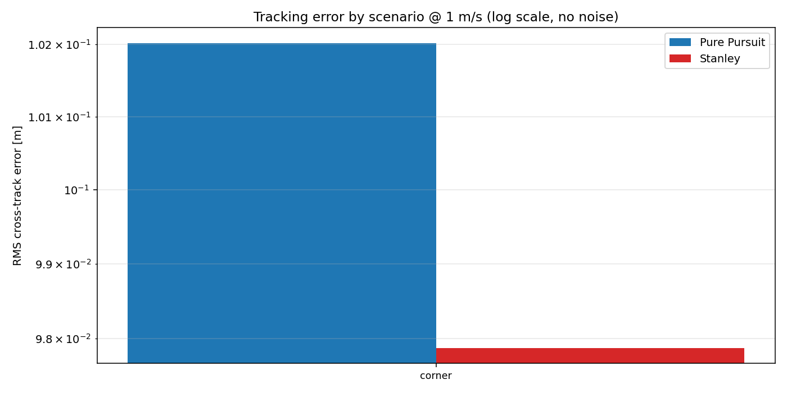
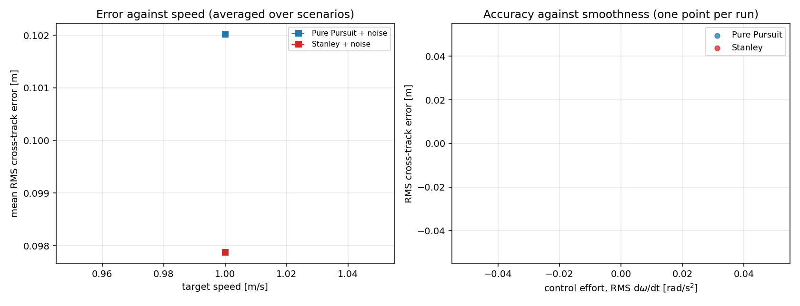

# Controller comparison in Gazebo

Generated by `analysis/compare_controllers.py` from `results/gazebo/metrics.csv`. Do not edit by hand: `scripts/run_comparison.sh` regenerates the whole file.

> These are physics-simulation runs, scored against the Gazebo ground-truth pose. They are **not** the controller comparison: the runs use a static `map -> odom` with AMCL disabled, so the error is dominated by odometry drift rather than by the control law, and Gazebo runs are not bit-reproducible. See [RESULTS.md](RESULTS.md) for the controller comparison proper.

## Conclusion

Too few scenarios here to draw a conclusion: on `corner` Stanley was closer (0.0979 m against 0.1020 m RMS). This is a single-route check, not the controller comparison — see docs/RESULTS.md for that, which covers seven scenarios at three speeds with and without odometry noise.

## How the comparison is kept fair

- Both controllers drive the **same** reference paths from the **same** start poses at the **same** speeds.
- The longitudinal (speed) law is shared code. Only the lateral control law differs, so a difference in tracking error cannot be explained by one controller simply taking corners slower.
- Cross-track error is reported at `base_link` for both, even though Stanley internally regulates the error at a virtual front axle.
- Errors are measured against **ground truth**, not against the noisy pose the controller was given.
- The odometry noise sequence is seeded from the scenario, speed and noise setting only, never from the controller, so both face an identical disturbance realisation.
- A 100 ms sensing latency is modelled, because without it the tuning step selects gains that are only optimal in a perfect world.
- Gains are fitted by grid search on `campus_loop`, `circle`, `corner`, `straight_offset` and reported on all scenarios, so the held-out routes test generalisation.

## Per-scenario, at 1 m/s, no noise

| Scenario | Tuned on | PP RMS (m) | Stanley RMS (m) | PP max (m) | Stanley max (m) | Closer |
| --- | --- | ---: | ---: | ---: | ---: | :---: |
| `corner` | yes | 0.1020 | 0.0979 | 0.2275 | 0.1999 | Stanley |

## Across speed and noise (averaged over all scenarios)

| Speed (m/s) | Noise | PP RMS (m) | Stanley RMS (m) | PP effort | Stanley effort |
| ---: | :---: | ---: | ---: | ---: | ---: |
| 1 | yes | 0.1020 | 0.0979 | 0.38 | 0.60 |

## Robustness

| Controller | Clean RMS (m) | Noisy RMS (m) | Noise penalty | Mean effort (rad/s²) | Failed runs |
| --- | ---: | ---: | ---: | ---: | ---: |
| Pure Pursuit | n/a | 0.1020 | n/a | 0.38 | 0 |
| Stanley | n/a | 0.0979 | n/a | 0.60 | 0 |

2 runs total, 0 of which failed to finish.

## Figures

### Tracking error by scenario

### Speed, noise and control effort

## Reading these numbers honestly

- `straight_offset` starts 1.0 m off the path, so its RMS is dominated by the recovery transient and is not comparable with the steady-state routes.
- These figures come from the kinematic benchmark, which models actuator lag, wheel saturation, sensing latency and odometry noise, but not wheel slip, tyre dynamics or LiDAR mis-association. The Gazebo runs exercise the identical controller code against a physics engine; see the README for how to reproduce them.
- Absolute errors are small because the plant is well behaved. The comparison between the two columns is the result, not the magnitude of either.
